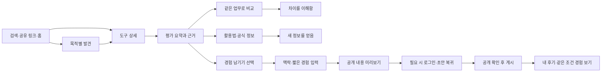

# AIs — 스코어 시각화·발견·참여 경험 심화 기획

작성일: 2026-09-30. 상태: 검토용 기획안. 실제 사용자 조사·새 UI 구현·운영 검증 결과가 아니다.

## 1. 제안의 핵심

**점수를 발견하는 호기심 → 내 상황에서 차이를 이해하는 만족 → 작은 경험을 보태는 참여**를 하나의 흐름으로 만든다. 정보를 얻고 떠나는 방문도 완결된 성공이다. 참여와 가입은 추가 선택이며, 점수나 근거를 읽기 위한 조건이 아니다.

사용자가 얻어갈 것은 숫자 자체보다 “어떤 일에 좋고, 어디를 확인해야 하며, 나와 비슷한 사람은 어떻게 썼는가”다. 재미는 새로운 기능의 발견, 조건을 바꾸며 차이를 이해하는 경험, 자신의 경험이 다른 사람에게 도움이 되는 감각에서 만든다.

첫 개선 범위는 **도구 상세의 평가 요약 → 같은 업무의 비교 → 단계형 후기 작성**이다. 홈은 이 흐름에 진입하는 작은 발견 영역부터 개선한다. 전면적인 메뉴 개편, 별도 포인트 경제, 개인 적합도 알고리즘은 이번 범위 밖이다.

기준 문서는 [통합 기획 v0.6](../../2026-09-12-product-plan-v0.6.md), [기존 디자인 선호](../../../design-previews/2026-09-12-selected-design/README.md), [디자인 보정 기준](../../../design-previews/2026-09-12-refined-app-detail/design-direction.md)이다. 본 문서는 전체 제품 방향을 대체하지 않고 해당 경험을 상세화한다.

## 2. 현재 확인한 상태와 개선 가설

분석 대상은 실제 기능이 모여 있는 `site/`다. 루트의 이전 Next.js MVP와 구분한다. 소스와 기존 참고 이미지를 검토했으며, 이번 작업에서 실행 화면을 새로 관찰하거나 이탈률을 측정하지는 않았다.

| 현재 확인한 사실 | 사용자에게 생길 수 있는 문제 — 검증할 가설 | 설계 대응 |
|---|---|---|
| 홈은 검색·도구·활용법·소식·경험을 제공하고, 도구 카드는 소개·분류·요금 중심이다 | 어떤 차이를 더 보면 좋을지 단서가 약할 수 있다 | 목적별 발견 카드와 비교 질문을 제공 |
| 상세의 평가 영역은 개요·기능·유의 사항 뒤에 있다 | 점수를 보러 온 사람이 첫 화면에서 핵심을 찾기 어려울 수 있다 | 상단에 평가 요약과 근거 진입점 배치 |
| 사용자 점수는 5개 항목의 가로 막대·평균·응답 수로 표시한다 | 평균만으로 의견의 갈림이나 내 업무와의 관련성을 해석하기 어렵다 | 조건·표본·최근 사용 시점을 먼저, 분포는 펼쳐보기로 제공 |
| 공식 직접 평가는 미평가로 표시한다 | 미평가를 서비스의 품질 부족이나 0점으로 오해할 수 있다 | 평가 상태와 확인된 기능 정보를 함께 제시 |
| 비교는 최대 3개 도구의 기능 목록을 나란히 표시하며 모바일은 가로 스크롤이다 | 동일 기능의 차이를 사용자가 직접 찾아야 할 수 있다 | 공통 비교 기준과 차이만 보기, 모바일 항목별 비교 |
| 후기 폼은 제목·본문·업무·플랜·사용일·닉네임·관계와 선택 점수 5개를 한 화면에 제공한다 | 가벼운 경험을 남기려던 사람이 긴 과제로 느낄 수 있다 | 맥락·경험·공개 확인의 3단계로 나눔 |
| 로그인 전 작성과 탭 내 초안 복구는 이미 구현돼 있다 | 이를 새로 설계하면서 기존 복구 동작이 퇴행할 수 있다 | 재사용을 기본으로 하고 단계·진입 맥락까지 보존 |
| 집계는 계정·도구별 최신 공개 후기 1건을 먼저 고르고 업무·플랜으로 필터링한다 | 업무별 최신 후기들이 모두 집계된다고 오해할 수 있다 | 현재 집계 단위를 명시; 변경은 별도 데이터 이행으로 취급 |
| 랭킹은 최근 후기 참여자 수 기준이다 | 성능 우열로 오해할 수 있다 | ‘최근 경험이 모인 도구’처럼 활동의 의미를 전면에 표시 |

주요 코드 근거: [홈](../../../site/app/page.tsx), [상세](../../../site/app/tools/[id]/page.tsx), [평가 UI](../../../site/components/ToolReviews.tsx), [집계 API](../../../site/app/api/scores/route.ts), [비교](../../../site/app/compare/page.tsx), [후기 폼](../../../site/components/Community.tsx), [초안 복구](../../../site/lib/community-draft.ts), [입력 검증](../../../site/lib/validation.ts), [랭킹](../../../site/components/Ranking.tsx).

## 3. 가능한 방향과 선택 이유

| 방향 | 핵심 경험 | 장점 | 부담·한계 | 제안 |
|---|---|---|---|---|
| A. 발견과 비교 중심 | 흥미로운 질문에서 시작해 조건별 차이를 알아봄 | 비회원·소량 데이터에서도 유익, 현재 구조 활용 가능 | 비교 기준과 콘텐츠 편집 필요 | 기본 방향 |
| B. 나에게 맞는 도구 진단 | 짧은 질문에 답하고 추천 이유를 받음 | 처음 도구를 고르는 사람에게 친절 | 입력 전에 가치를 못 볼 수 있고 적합도 과장 위험 | ‘조건 좁히기’ 선택 기능으로 결합 |
| C. 참여 놀이 중심 | 투표·미션·배지로 경험 공유 | 가벼운 재방문 동기 | 초기에는 빈 활동, 점수 조작, 무의미한 참여를 만들 수 있음 | 결과 비교·유용한 반응만 작게 도입 |

**A를 중심에 두고 B의 짧은 조건 입력, C의 발견·기여 피드백을 제한적으로 결합한다.** 첫 화면부터 설문이나 로그인으로 시작하지 않는다. ‘참여하면 결과 공개’ 방식으로 정보를 잠그지 않는다.

## 4. 방문 목적과 성공 순간

| 방문자 상황 | 첫 질문 | 1차 가치 | 선택적 다음 행동 |
|---|---|---|---|
| 가볍게 둘러보는 사람 | 요즘 어떤 기능이 쓸 만하지? | 몰랐던 쓰임 한 가지를 이해 | 관련 활용법 보기 |
| 두 도구를 고민하는 사람 | 이 업무에서는 뭐가 다르지? | 중요한 차이·제약을 설명 가능 | 비교 저장 또는 공식 서비스 방문 |
| 이미 사용하는 사람 | 나만 이렇게 느끼나? | 같은 조건의 경험과 내 경험을 구분 | 짧은 후기 남기기 |
| 재방문자 | 지난번에 본 정보가 달라졌나? | 확인된 변경 내용과 영향 이해 | 이전 비교 다시 보기 |

처음에는 한국어 실무자에게 익숙한 보고서 작성·자료 조사·회의 정리 같은 업무로 검증한다. 이를 전체 카탈로그의 영구적인 범위 제한으로 해석하지 않는다.

## 5. 사용자 경로

### 경로 A — 발견만 하고 나가도 유익

홈의 ‘회의록에서 확인할 세 가지’ → 관련 기능과 제약 → 예시 결과와 출처. 여기서 종료해도 성공이다. 참여 요청은 콘텐츠를 읽는 도중 끼워 넣지 않고 끝부분에 작은 선택으로 둔다.

### 경로 B — 점수에서 비교로

검색 ‘보고서 작성’ → 도구 상세의 업무 맥락 유지 → 평가의 품질·효율 차이 확인 → 유사 도구 1개 추가 → 같은 업무·조건으로 비교 → 선택에 도움이 된 차이를 이해한다. 선택이 ‘현재 도구 유지’나 ‘판단 보류’여도 정상 결과다.

### 경로 C — 읽다가 경험 남기기

사용자 경험 영역 → ‘내 경험 남기기’ → 도구는 이미 지정 → 업무·플랜·사용일 확인 → 선택 항목 평가와 한 줄 경험 → 공개 미리보기 → 필요한 경우 로그인 → 미리보기로 복귀 → 명시적으로 게시 → 내 후기 확인.

### 경로 D — 변경을 확인하고 돌아가기

저장한 비교 또는 관심 도구 → ‘지난 확인 이후 변경된 조건’ → 공식 변경과 재평가 여부 확인 → 필요할 때 비교 갱신. 확인된 변경 데이터가 없으면 ‘변화 없음’을 추정하지 않고 마지막 확인 시점만 보여준다. 자동 이메일·푸시는 이번 기획에 추가하지 않는다.

## 6. 스코어의 의미부터 분리한다

사용자에게 숫자 하나로 합쳐 보여주지 않을 네 가지 정보가 있다.

| 정보 | 답하는 질문 | 표현 | 섞으면 안 되는 값 |
|---|---|---|---|
| 직접 평가 | 같은 과제를 수행했을 때 어땠나? | 평가 항목, 과제, 플랜·버전, 평가일, 실행 수, 근거 | 사용자 인기·저장 수 |
| 사용자 경험 | 써본 사람은 어떻게 느꼈나? | 자기보고 점수, 응답 수, 사용 맥락, 개별 후기 | 검수된 성능으로 보이는 표현 |
| 조건 충족 | 내가 필요한 기능을 쓸 수 있나? | 충족·조건부·미충족·미확인 | 임의의 개인 적합도 백분율 |
| 관심·참여 | 최근 무엇에 경험이 모이나? | 기간이 명시된 참여자 수 | 성능 점수·우승 배지 |

상단 요약에는 ‘사용자 경험 · 보고서 작성 · Pro · 항목별 5점’처럼 종류와 조건을 같이 쓴다. 전체 업무·플랜을 합친 결과에는 반드시 ‘여러 사용 조건이 섞인 결과’를 표시하고, 이를 특정 업무의 추천 결론으로 쓰지 않는다.

### 6.1 시각화의 3단계 깊이

| 깊이 | 화면에 항상 보이는 내용 | 사용자 행동 |
|---|---|---|
| 빠른 파악 | 어떤 평가인지, 업무·플랜, 핵심 항목 최대 2개, 응답 수·상태 | 평가 자세히 보기 |
| 차이 이해 | 5개 항목 가로 막대, 같은 조건 비교, 항목 설명 | 항목을 눌러 이유·분포 확인 |
| 근거 확인 | 점수 분포, 해당 후기, 사용 시점, 집계 방식·출처 | 원문 확인·경험 추가 |

핵심 항목은 높은 점수 순으로 고르지 않는다. 업무별로 사전에 정한 항목을 사용하며, 첫 버전의 기본은 결과 품질과 작업 효율이다. 사용자는 나머지 항목을 언제든 펼칠 수 있다.

주 시각화는 현재의 가로 막대를 발전시킨다. 공통 길이·0–5 고정 범위·숫자 라벨을 사용한다. 입력 가능한 점수는 1–5이며 0은 막대의 시각적 기준점일 뿐 유효 평가가 아니다. 미평가는 막대와 수치를 그리지 않고 텍스트로 표시한다. 방사형 차트나 거대한 종합 점수 원은 첫 버전에서 제외한다. 비교할 때 항목별 차이를 읽는 목적에 맞춘 설계 판단이다.

분포는 1–5점별 응답 수를 펼쳐 볼 수 있도록 제공한다. 소수 표본에서는 비율보다 실제 건수를 먼저 쓴다. 현재 API에는 분포가 없으므로 새 집계가 준비되기 전에는 기존 평균에서 분포를 만들어내지 않는다.

### 6.2 표본·날짜·변화 표시 규칙

아래 5명 경계는 통계적 신뢰도를 보장하는 수치가 아니라, 작은 표본을 과장하지 않기 위한 초기 UI 정책 제안이다. 사용자 테스트와 데이터 분포를 보고 재검토한다.

| 항목별 유효 응답 수 | 요약 표현 | 상세 표현 |
|---|---|---|
| 0 | 아직 평가 없음 | 공식 기능·이용 조건·관련 활용법 안내 |
| 1–4 | 경험 3건 · 초기 의견처럼 실제 수 표시 | 개별 평가 우선, 평균을 보이면 ‘소수 응답 평균’과 건수를 동반 |
| 5 이상 | 항목 평균 4.2/5 · 8명 응답처럼 표시 | 분포와 후기로 연결; 대표성이나 검증된 성능으로 주장하지 않음 |

위 숫자는 모두 표시 형식의 가상 예시다. 실제 점수·추천으로 사용하지 않는다. `sample`은 조건에 맞는 후기 작성 계정 수이고, 항목별 `count`는 실제 점수 응답 수다. 점수 없는 후기까지 특정 항목의 분모에 포함하지 않는다.

후기 최종 수정일과 실제 사용일은 구분한다. 현재 API의 `latest`는 `updated_at`이므로 ‘최근 사용일’이나 ‘최근 테스트일’로 표기하면 안 된다. 초기 개선은 ‘후기 갱신일’로 표시하고, 사용일 범위는 집계를 추가한 뒤 제공한다.

급상승 화살표·이전 대비 점수는 동일한 집계 기준의 과거 데이터가 확보될 때만 제공한다. 모집단·과제·플랜이 바뀌면 단순 전후 차이를 성능 개선으로 표현하지 않는다. 오래된 후기의 사용일은 표시하되 임의의 날짜 기준으로 성능을 무효 처리하지 않는다. 공식 업데이트와 충돌하면 재확인 상태를 별도로 표시한다.

### 6.3 점수 입력의 언어

숫자만 놓인 드롭다운을 **설명 있는 1–5 선택 버튼 + 판단 어려움**으로 바꾼다. 3점을 미리 선택하지 않는다. ‘판단 어려움’은 미응답 상태로 저장하고 0점으로 계산하지 않는다. 첫 버전에서는 현재 스키마와 맞춰 해당 축을 생략한다.

| 항목 | 사용자에게 묻는 질문 | 1 / 3 / 5의 초기 기준 |
|---|---|---|
| 결과 품질 | 원하는 결과에 얼마나 가까웠나요? | 거의 다시 만듦 / 수정해 쓸 수 있음 / 거의 그대로 활용 |
| 작업 효율 | 확인·수정을 포함해 수고가 줄었나요? | 더 들었음 / 비슷했음 / 크게 줄었음 |
| 한국어 | 한국어 이해와 표현이 어땠나요? | 작업에 지장 / 수정하면 사용 / 자연스럽게 사용 |
| 비용 대비 | 이용 비용에 비해 도움이 됐나요? | 비용 대비 낮음 / 보통 / 비용 대비 높음 |
| 작업 연결 | 다음 작업으로 옮기기 쉬웠나요? | 재작업이 많음 / 수동 정리로 연결 / 자연스럽게 연결 |

2·4는 양옆 기준의 중간 단계로 설명한다. 비용을 판단할 근거가 없으면 비용 대비는 건너뛸 수 있다. 무료 사용자의 응답은 무료 플랜의 경험으로 남기며 유료 플랜의 비용 효용으로 읽지 않는다. 이는 새 사용자 입력 안내 초안이며, 기존 점수가 이 기준으로 작성됐다고 소급해 주장하지 않는다. 새 안내 배포 시 `rubricVersion`을 기록하고 구버전은 ‘이전 입력 기준’으로 구분한다.

## 7. 화면별 설계

### 7.1 홈·발견 — 궁금한 일에서 출발

검색과 업무 바로가기를 유지하고, 기존 도구 목록 위나 첫 목록 안에 작은 ‘비교하며 알아보기’ 영역을 둔다. 첫 실험은 3개의 편집 카드로 제한한다.

- 기능 발견: ‘회의록에서 할 일을 추리는 방법’ — 가능한 도구·준비물·실제 예시로 연결.
- 비교 질문: ‘보고서 초안, 출처 확인은 어디서 할까?’ — 같은 목적의 후보 비교로 연결.
- 경험 관점: ‘같은 도구라도 업무별 평가는 어떻게 다를까?’ — 실제 응답이 있는 경우만 노출.

카드는 질문 한 줄, 확인할 차이 한 줄, 콘텐츠 종류·확인일로 구성한다. 인기·추천·새 소식 배지는 실제 선정 기준이 있을 때만 붙인다. ‘오늘’이라는 표현도 매일 검수할 운영 체계가 생기기 전에는 사용하지 않는다.

### 7.2 도구 상세 — 개요와 판단을 가깝게

읽기 순서는 **도구 소개 → 선택 중인 업무 → 평가 요약·주요 제약 → 기능 → 깊은 평가·후기 → 유사 도구**다. 상단에는 ‘비교에 담기’를 주된 내부 행동으로, 공식 사이트·저장을 보조 행동으로 배치하는 안을 검증한다. CTA 우선순위가 공식 사이트 방문 목적을 방해하는지도 확인한다.

데스크톱은 평가 요약과 기능 조건을 병렬로 배치할 수 있다. 모바일은 평가 요약 다음에 가장 중요한 조건 3개를 제공한다. 전체 기능·전체 평가는 펼쳐보거나 해당 섹션으로 이동한다. 상단 요약과 하단 자세한 평가가 같은 데이터를 사용하도록 한다.

직접 평가와 사용자 경험은 각각 제목·상태를 가진 영역으로 구분한다. 직접 평가가 없으면 짧게 ‘직접 평가 준비 전’이라고 표시하고, 사용자 경험 또는 공식 기능 정보를 이어 보여준다. 빈 그래프 다섯 개를 첫 화면의 주인공으로 만들지 않는다.

### 7.3 비교 — 같은 질문에 답하는 화면

최대 3개 비교와 비회원 접근을 유지한다. 화면 상단에 업무와 적용 플랜을 고정하고, **핵심 차이 → 공통 기능 기준 → 조건에 맞는 평가 → 자세한 출처** 순으로 정리한다.

| 요소 | 행동 규칙 |
|---|---|
| 비교 도구 선택 | 2개부터 시작, 세 번째는 선택; 1개면 관련 후보를 바로 추가 가능 |
| 업무 | 이전 탐색의 조건을 유지; 변경하면 모든 비교 열에 적용 |
| 플랜 | 도구별 플랜을 명시; 이름이 다르다고 서로 같은 가격·조건으로 취급하지 않음 |
| 차이만 보기 | 공통 필드가 정규화된 행에서 작동; 알 수 없는 값은 차이로 단정하지 않음 |
| 점수 | 동일 항목·업무의 값만 나란히 표시; 표본과 사용 조건을 각 열에 표시 |
| 미확인 | 빈칸이나 X 대신 ‘확인 필요’; 확인된 일부 조건을 함께 설명 |
| 다음 행동 | 비교 저장·근거 확인·다른 후보로 교체; 가입 없이 읽기 완료 가능 |

기능명의 문자열만 맞춰서 공통 기능이라고 판단하지 않는다. 먼저 검수된 공통 기능 ID와 도구별 지원 조건의 대응표가 필요하다. 이 대응표가 없는 단계에서는 기존 기능 원문을 유지한다.

모바일은 항목별 세로 묶음 안에서 도구 A·B·C의 값을 연속으로 읽게 한다. 도구명과 비교 기준을 반복 표시해 기억 부담을 줄인다. 점수·조건의 핵심 비교를 가로 스크롤 하나에만 의존하지 않는다.

### 7.4 후기 작성 — 세 단계, 입력과 공개를 분리

긴 글을 잘 써야 한다는 부담부터 줄인다. ‘평가 작성’ 대신 ‘내 경험 남기기’, 내용 안내는 ‘했던 일과 좋았거나 막힌 점을 한 줄로 적어주세요’로 제안한다. ‘30초 완성’ 같은 시간 약속은 실제 테스트 전에 사용하지 않는다.

| 단계 | 묻는 것 | 부담을 줄이는 방식 |
|---|---|---|
| 1. 사용 맥락 | 업무, 플랜, 실제 사용일 | 도구는 진입 화면에서 지정; 업무·플랜은 후보 선택+직접 입력; 알 수 없는 플랜 선택 가능 |
| 2. 경험 | 한 줄 경험 필수, 항목별 점수 선택 | 주 평가 항목 1개부터 선택 가능; 다른 항목은 펼치기; 긴 글은 추가 설명으로 확장 |
| 3. 공개 확인 | 실제 게시 카드, 닉네임, 관계, 공개 동의 | 제목 자동 제안 후 수정 가능; 공개 범위를 보고 게시 |

현재 제목·본문 필수 정책은 유지하되, 제목은 확인된 업무와 도구명으로 만든 중립적인 제안을 미리보기에서 수정할 수 있게 한다. 사용자의 의견이나 본문을 자동 생성하지 않는다. 초안 단계에서 대표 점수만 골라도 아직 게시된 후기가 아니다.

상세의 업무·플랜 필터는 사용 사실이 아니므로 자동 확정하지 않는다. 후보로 전달하고 사용자가 확인하게 한다. 날짜를 오늘로 조용히 확정하지 않고 직접 선택하게 하며, ‘오늘 사용’을 누른 경우에만 오늘을 기록한다. 플랜 ‘잘 모르겠음’은 미확인으로 표시하고 특정 플랜 집계에 넣지 않는다. 정확한 사용일이 기억나지 않으면 날짜를 만들어 넣지 않고 일반 경험 글로 전환할 수 있게 한다. 전환 시 점수는 후기 집계에 포함되지 않음을 설명한다.

기존 사용자 닉네임은 재사용하되 수정 가능하게 한다. 관계 항목은 ‘없음 / 제작·운영 관계 / 제품·비용 지원받음’을 공개 확인에서 명시적으로 고른다. 상세 점수를 모두 채워야 제출할 수 있는 구조는 만들지 않는다.

비회원은 먼저 입력하고 미리보기까지 볼 수 있다. ‘로그인 후 게시 준비’를 누르면 로그인하고 단계 3으로 돌아온다. **로그인 성공만으로 게시하지 않는다.** 공개 동의는 자동 복원하지 않고 다시 확인한다. 게시 버튼은 실제 게시 요청 때만 ‘게시하기’로 표시한다.

게시 성공 후에는 내 후기와 수정·삭제 진입점을 보여준다. ‘같은 조건의 다른 경험 보기’를 보조 행동으로 제공한다. 기여로 평균이 얼마나 올랐는지 과장하거나 높은 점수를 유도하는 보상을 제공하지 않는다.

## 8. 참여의 깊이를 선택할 수 있게

| 깊이 | 행동 | 즉시 얻는 가치 | 구현 범위 |
|---|---|---|---|
| 읽기 | 기능·평가·활용법 열람 | 새로운 정보 | 기존 경로 개선 |
| 탐색 | 업무 칩 선택, 비교 추가 | 관련 정보와 차이 | 초기 |
| 반응 | 도움이 된 후기에 반응 | 표시 상태·취소 가능 | 기존 로그인 정책 유지 |
| 짧은 경험 | 맥락+한 줄, 점수는 선택 | 경험 정리와 공개 기록 | 초기 |
| 상세 기여 | 여러 항목 평가, 활용법·출처 제안 | 더 풍부한 설명 | 기존 작성 흐름과 연결 |

첫 버전에서는 계정 없는 반응을 성급하게 새로 추가하지 않는다. 콘텐츠 유익성 설문은 이미 별도 기능이므로 공개 평가와 합치지 않는다. ‘도움 됐어요’, 사용 경험 점수, 관심 투표는 각각 다른 데이터다.

재미를 만드는 우선 요소는 목적에 맞는 작은 발견, 비교 조건에 따른 즉각적인 결과 변화, 내가 남긴 경험의 명확한 완료 상태다. 연속 출석, 무작위 보상, 참여 횟수 경쟁, 긍정 후기 보상은 제외한다. 이후 ‘기여가 도움이 됐다는 반응’을 보여주더라도 실제 집계와 수정·삭제 권한을 함께 제공한다.

## 9. 빈 상태·실패·복구

| 상태 | 사용자에게 보일 내용과 행동 |
|---|---|
| 후기 0건 | ‘아직 이 조건의 경험이 없어요’ + 공식 기능·조건 + 선택적인 첫 경험 작성 |
| 소수 표본 | 실제 건수와 개별 경험; 점수 우열·대표성 문구 제외 |
| 조건 변경 중 | 기존 값을 새 조건의 결과처럼 보이지 않게 로딩 표시; 늦은 응답 무시 |
| 선택 조건의 결과 없음 | 선택 조건을 보여주고 ‘조건 넓히기’ 제공; 자동으로 완화하지 않음 |
| 평가 API 실패 | 공식 정보는 계속 표시; 평가 영역만 재시도; 전체 페이지 새로고침 최소화 |
| 로그인을 취소함 | 초안과 복귀 경로 유지; 읽던 화면으로 돌아가기 제공 |
| 초안 저장 불가 | 로그인 이동 전에 알림, 내용 복사와 현재 화면 유지 선택 |
| 게시 응답 유실 | ‘게시 여부를 확인하고 있어요’; 제출 ID로 결과 확인 후 재시도 |
| 공개 후 수정·삭제 | 본문과 집계에 반영; 기존 정책상 이전 공개 후기가 다시 최신으로 선정될 수 있음을 검증 |
| 모바일 키보드 열림 | 현재 질문과 오류·다음 버튼에 접근 가능; 고정 바가 입력을 덮지 않음 |

현재 초안 보관은 `sessionStorage` 기반으로 같은 탭에서만 보장한다. 탭 종료 후·다른 기기 복구를 약속하지 않는다. 여러 도구·글 종류·작성 단계의 초안 충돌을 피하도록 키와 버전을 설계한다. 비공개 입력 내용은 URL·분석 이벤트에 넣지 않는다.

게시 중복 방지는 UI에서 버튼을 잠그는 것만으로 완료되지 않는다. 현재 API에는 제출 멱등 키가 없으므로, 서버가 수락한 뒤 응답이 사라지는 경우를 다루려면 계정에 묶인 `submissionId`와 결과 재조회가 필요하다. 그 기반이 생기기 전에는 ‘안전한 자동 재시도 완료’로 표현하지 않는다.

## 10. 시각 언어와 상호작용

기존 노랑·코발트 블루·아이보리 방향을 유지한다. 노랑은 선택 맥락과 발견 포인트, 파랑은 주요 행동과 평가 막대에 사용한다. 점수가 높다는 이유만으로 노랑을 쓰거나, 색 하나로 정확성·우수성을 암시하지 않는다.

| 요소 | 제안 규칙 |
|---|---|
| 본문 | 모바일 기본 16px; 작은 보조 정보도 읽을 수 있는 크기와 대비로 검증 |
| 제목 | 기존의 성숙한 산세리프와 절제된 굵기 유지 |
| 정보 묶음 | 모든 요소를 카드화하지 않고 정렬·구분선·간격으로 묶음 |
| 점수 | 소수 1자리, 고정 폭 숫자, 항목별 응답 수, 같은 축 범위 |
| 상태 | 텍스트+필요한 아이콘; 색만으로 상태 구분하지 않음 |
| 선택 | 선택됨·해제·수정 가능 상태를 명시; 별도 저장 없이 조건 변경 반영 |
| 모션 | 조건 변경·선택 피드백에 짧게 사용; 점수 카운트업·과장된 축하 제외 |
| 동작 감소 | reduced-motion 환경에서 결과를 즉시 표시 |
| 터치 | 주요 버튼·점수 선택의 터치 영역 44×44 CSS px를 제품 목표로 설정 |

44px는 본 기획의 사용성 목표다. WCAG 2.2 AA의 2.5.8은 예외 조건을 포함해 최소 24×24 CSS px 또는 지정 간격 등을 다루므로 두 값을 혼동하지 않는다. [W3C Target Size](https://www.w3.org/WAI/WCAG22/Understanding/target-size-minimum).

점수 선택은 키보드로 이동 가능한 라디오 그룹으로 제공하고 선택값을 읽어준다. 막대만으로 정보를 전달하지 않고 텍스트 값과 목록을 함께 제공한다. 단계 이동 시 제목으로 포커스를 이동하며 뒤로 가면 기존 값과 수정 위치를 유지한다. 비교·조건·작성의 고정 영역이 겹치지 않도록 화면당 하단 고정 행동은 하나만 둔다.

## 11. 현재 구조와 연결할 개발 범위

기획을 시각적 수정만으로 취급하면 집계·복구의 실제 동작과 어긋날 수 있다. 화면 변경과 데이터 변경을 구분한다.

| 제안 단위 | 책임 | 의존하는 것 |
|---|---|---|
| ScoreSummary | 종류·조건·핵심 항목·표본·상태 요약 | 현재 scores 응답, 도구 정보 |
| ScoreBreakdown | 5개 항목과 접근 가능한 수치 표시 | 항목별 count·value |
| ScoreEvidence | 분포·조건에 맞는 후기·방법 | 신규 분포 집계, 동일 집계 범위의 후기 조회 |
| ComparisonView | 공통 항목·차이 표시·모바일 구성 | 도구별 기능 대응표, 비교 조건 |
| ReviewComposer | 단계 전환·검증·미리보기 | 기존 PostForm·postSchema |
| ReviewDraft | 단계·값·진입 맥락 보관·복구 | 기존 community-draft, 로그인 복귀 |
| ReviewSubmission | 중복 방지·게시 결과 확인 | 커뮤니티 API·계정별 제출 ID |

컴포넌트 이름은 경계 제안이다. 구현 시 기존 폴더와 실제 재사용성을 보고 확정한다. 점수 표시 모듈이 사용자 입력 축 정의까지 소유하는 현재 의존성은 공통 평가 정의 모듈로 분리하는 후보이며, 관련 변경에 한정한다.

### 데이터 계약에서 먼저 결정할 사항

1. **집계 단위 유지:** 첫 개선에서는 계정·도구별 최신 공개 후기 1건을 먼저 선택하고 조건을 적용한다. 업무별 최신 1건으로 바꾸려면 별도 마이그레이션·문구·회귀 검증이 필요하다.
2. **원문 연결:** 점수의 근거 목록은 집계에 사용한 후기와 같은 범위여야 한다. 단순히 도구의 모든 후기를 보여주고 ‘이 점수의 근거’라고 부르지 않는다.
3. **업무·플랜 식별자:** 초기에는 기존 텍스트와 검수된 후보를 활용한다. 다음 단계에서 `taskId`, 도구별 `planId`, 명시적인 unknown을 도입하고 기존 자유 입력값은 검수 없이 임의 병합하지 않는다.
4. **평가 안내 버전:** 새 기준의 입력에는 버전을 기록한다. 혼합된 기준임을 숨기지 않으며, 기준별 비교가 필요하면 필터를 제공한다.
5. **기능 리뷰 분리:** 현재 코드의 도구 후기에 기능 ID 경로를 구현한 것으로 가정하지 않는다. [기능 리뷰 기획](2026-09-16-ai-feature-review-design.md)과 연결하되 기능 점수를 도구 점수에 자동 합치지 않는다.
6. **불확실한 값 보존:** 미평가·미확인·직접 평가 없음은 서로 다른 상태다. 데이터 모델과 화면 모두에서 구분한다.

## 12. 콘텐츠 운영과 초기 데이터

처음에는 데이터가 적어도 정보 경험이 성립해야 한다. 검수된 기능 비교·활용법·공식 변경을 공급하고, 후기가 생긴 도구부터 사용자 경험을 더한다. 가짜 후기, 시연용 점수, 부풀린 참여자 수로 빈 상태를 채우지 않는다.

편집 카드마다 작성자·확인일·출처·다음 검토 계기를 기록한다. 모든 카드를 매일 갱신하는 운영 약속 대신, 관련 기능·플랜 변경이나 오류 제보가 들어오면 검토한다. 직접 평가는 검토자·과제·실행 결과가 준비된 경우에만 공개한다.

후기 수가 늘면 관계자·지원받은 후기의 분리 필터와 집계 포함 기준을 제공하는 것이 후속 과제다. 현재 집계에 관계자 제외 규칙이 있다고 가정하지 않는다. 초기에는 개별 관계 표시를 유지하며 전체를 ‘독립적인 고객 의견’으로 부르지 않는다.

## 13. 성공 기준과 검증 계획

### 첫 사용성 검증

우선 탐색 목적 3–4명, 참여 목적 3–4명을 모집하는 소규모 형성 평가를 제안한다. 표본은 문제 발견용이며 전체 사용자에 대한 통계적 효과를 추정하지 않는다. 같은 사람에게 모든 경로를 연달아 수행시키지 않는다.

| 검증 과제 | 관찰할 것 | 초기 통과 목표 — 제안치 |
|---|---|---|
| 상세의 점수 의미 설명 | 사용자 경험/직접 평가, 업무·플랜·응답 수를 구분하는가 | 참여자 중 80% 이상이 도움 없이 설명 |
| 두 도구 비교 | 차이 1개와 확인할 조건 1개를 찾는가 | 80% 이상이 2분 안에 설명 |
| 짧은 후기 작성 | 필수/선택 구분, 단계·뒤로 가기 이해 | 로그인 시간을 제외하고 중앙값 90초 이내 |
| 소수 표본·미평가 해석 | 1명 평균을 검증된 성능으로, 미평가를 0점으로 오해하는가 | 치명적인 오해가 발생하면 출시 전 수정 |
| 로그인·연결 실패 복구 | 입력 유지와 공개 상태 이해 | 준비된 모든 시나리오에서 입력 유실·자동 게시 0건 |
| 모바일·키보드 | 390px/320px, 확대, 키보드·스크린리더 | 주요 정보·입력·오류·게시 행동 접근 가능 |

소규모 비율은 반드시 ‘4/5명’처럼 실제 분자·분모도 함께 보고한다. 목표 수치는 실측 전 약속이나 현재 성과가 아니다. 순서 효과를 줄이기 위해 기존 화면과 제안 화면의 과제 순서를 바꿔 관찰한다.

### 운영 지표

| 목적 | 지표와 분모 | 해석의 제한 |
|---|---|---|
| 정보를 얻음 | 선택형 질문의 ‘차이를 이해했다’ 응답 / 유효 응답 | 무응답 포함 전체 방문자의 이해율로 주장하지 않음 |
| 근거 탐색 | 근거 열기 세션 / 평가 요약 노출 세션 | 클릭만으로 이해를 증명하지 않음 |
| 비교 이용 | 2개 이상 비교 결과 노출 / 비교 시작 | 구매·선택 완료와 별개 |
| 참여 부담 | 게시 성공한 고유 작성 흐름 / 작성 시작 흐름 | 닫기·나중에 작성도 함께 확인 |
| 인증 마찰 | 초안 복귀 / 로그인 시작 | 로그인 취소와 기술 실패 분리 |
| 입력 품질 | 맥락·구체적 경험이 있는 후기 / 표본 검토한 후기 | 후기가 길거나 점수가 높다고 품질이 높은 것은 아님 |

이벤트 후보는 `score_summary_view`, `score_evidence_open`, `compare_start`, `compare_result_view`, `review_start`, `review_step_complete`, `auth_return`, `review_submit_success`, `review_submit_failure`다. 제출 성공은 서버 성공과 제출 ID 기준으로 중복 제거한다. 비회원 세션을 고유 인원으로 부르지 않는다. 본문·닉네임·자유 입력 업무·비공개 메모는 분석 이벤트에서 제외한다.

평균 점수 상승·글 수 증가·체류 시간만으로 성공을 결정하지 않는다. 참여율이 늘어도 점수 의미를 더 자주 오해하거나 후기의 구체성이 줄면 설계를 재검토한다.

## 14. 실행 우선순위와 출시 경계

| 단계 | 산출물 | 선행 조건 | 완료 기준 |
|---|---|---|---|
| 1. 상세·평가 이해 | 상단 요약, 조건·표본·갱신일, 미평가 상태, 5개 항목 설명 | 현재 데이터로 표현 가능한 범위 확정 | 점수 의미·미평가 해석 과제 통과 |
| 2. 입력·복구 | 3단계 후기, 미리보기, 초안·인증 복귀, 중복 게시 대응 | 스키마 호환성과 제출 ID 계약 | 입력 유실·자동 게시·중복 방지 검증 |
| 3. 비교 | 공통 기준, 차이만 보기, 모바일 항목별 구성 | 검수된 기능 대응표 | 같은 업무의 차이를 설명 가능 |
| 4. 근거·발견 확장 | 분포·조건별 근거, 목적별 홈 카드 | 집계 확장·콘텐츠 검수 | 숫자·원문 범위 일치, 실제 콘텐츠만 노출 |

위 순서는 의존성에 따른 작업 순서이며, 일정 추정은 아니다. 사용자 경험의 설득력은 1–3단계를 연결한 시안으로 먼저 확인한다. 실서비스에 한 번에 반영할 필요는 없으며 단계별로 기존 경로의 회귀를 검증한다.

후속 화면 설계에서 필요한 상태는 상세(후기 충분/소수/없음/실패), 비교(1개/2개/3개/조건 불일치), 후기(각 단계/오류/비회원 복귀/게시 완료), 홈 발견(콘텐츠 있음/적음)이다. 정상 화면 하나만으로 완료 판정하지 않는다.

## 15. 먼저 검토할 구체적 결정

- 서비스의 첫 인상은 ‘발견과 비교’로 유지하고, 개인 진단은 선택적인 조건 좁히기로 제공한다.
- 숫자 하나의 종합 점수 대신 업무별 핵심 항목과 표본·근거를 보여준다.
- 후기는 **한 줄 경험 필수 + 점수 선택**을 기본으로 하고, 점수만 찍은 입력은 공개 후기와 구분한다.
- 첫 UI 설계 대상은 **도구 상세 → 비교 → 후기 3단계**의 연결된 경로다.
- 소수 표본 표현, 새 입력 기준, 미확인 플랜, 제출 중복 대응은 화면 설계와 함께 확정할 제품 정책이다.

## 16. 외부 설계 근거와 적용 범위

확인일: 2026-09-30. 아래 문서는 설계 원칙의 참고이며 AIs의 개선 효과를 증명하는 사용자 조사 자료는 아니다.

- [GOV.UK Question pages](https://design-system.service.gov.uk/patterns/question-pages/): 필요한 질문만 묻기, 불확실한 응답 수용, 이미 입력한 값의 재사용을 참고했다. AIs에서는 관련 질문을 3단계로 묶는 안으로 적용하며 입력마다 별도 페이지를 강제하지 않는다.
- [GOV.UK Check answers](https://design-system.service.gov.uk/patterns/check-answers/): 제출 전에 내용을 확인·수정하는 패턴을 공개 후기 미리보기에 적용한다.
- [W3C Redundant Entry](https://www.w3.org/WAI/WCAG22/Understanding/redundant-entry.html): 같은 과정에서 다시 묻는 정보를 줄이고 이전 값을 재사용하는 근거다. 조회 중이던 플랜을 실제 사용 플랜으로 단정하는 근거는 아니다.
- [W3C Target Size](https://www.w3.org/WAI/WCAG22/Understanding/target-size-minimum): 터치 크기와 간격 기준을 확인했다. 본 기획의 44px 제품 목표와 표준의 최소 기준을 구분한다.

## 17. 자체 검토 기록

기존 통합 기획과 정보 중심 홈·공개 열람·점수 분리 원칙을 대조했다. 현재 구현과 신규 데이터 요구를 구분했고, 숫자 예시는 가상이며 효과·시간 목표는 검증 전임을 명시했다. 최신 후기 선정 순서, 날짜 의미, 자동 게시 금지, 미평가·미확인 구분, 기능 리뷰 미구현 가정을 점검했다. 새 코드·화면·운영 데이터는 변경하지 않았다.
